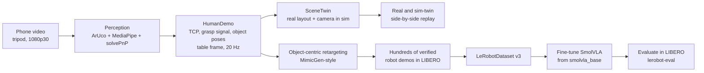

# hurobo: from phone video of a human hand to a robot policy in simulation

This project trains a small robot foundation model (SmolVLA, 450M parameters) with data from phone videos of a human hand. The policy runs on a Franka Panda arm in the LIBERO simulator.

The robot is not teleoperated. The simulated table is a copy of the real table. The Panda repeats what the human hand did on it.

The challenge brief is in [CHALLENGE.md](CHALLENGE.md). The schedule and gates are in [PLAN.md](PLAN.md). The real2sim research notes are in [REAL2SIM_IDEAS.md](REAL2SIM_IDEAS.md).

---

## 1. Goal, constraints, limitations

**Goal.** Train a small VLA only with data that I recorded with a phone. The policy must do a pick-and-place task (bowl onto plate) in simulation.

**Resource constraints**

| Constraint | Effect on the design |
|---|---|
| One laptop: RTX A5500 16 GB, 24 CPU threads, 62 GB RAM | Use a 450M-parameter VLA in bf16. Do not use 3B or 7B models. Use ACT as a fallback. |
| NVIDIA driver 560.35 (CUDA 12.6 maximum) | Install PyTorch from the cu126 index. Isaac Sim 5 and PolaRiS do not work. Use MuJoCo. |
| About 7 days. Long work days only on Friday to Sunday. | Start long jobs (generation, training) at the end of a short session. Each block has a gate and a fallback ([PLAN.md](PLAN.md) §5). |
| The data must come from me, with a phone | About 15 third-person clips on a tripod. One camera. No depth sensor. No motion-capture glove. |
| Public repository | Do not commit large files. The repository contains scripts and a link to the dataset on the Hugging Face Hub. |

**Limitations**

- **No physical robot.** The policy is evaluated in simulation only. This project makes no claim about real-world transfer.
- **Distribution shift.** The data comes from a human hand in a real room. The policy runs on a Panda in a rendered scene. The gap has four parts: appearance (real pixels and rendered pixels), embodiment (hand and parallel-jaw gripper), timing and dynamics, and object geometry. Section 3 describes how each approach treats the gap.
- **One camera, markers needed.** The metric hand pose comes from MediaPipe, `solvePnP` and ArUco markers on the table and objects. This limits where and how I can record.
- **Simplified orientation.** Retargeted grasps use a fixed top-down gripper orientation. The yaw comes from the object.
- **One task family.** Bowl on plate. This project makes no claim for other tasks.

---

## 2. Storyline



1. **Record** human demonstrations with a tripod. Use a ChArUco-calibrated camera. Put printed ArUco markers on the table, bowl and plate.
2. **Extract** a metric TCP trajectory (midpoint of thumb tip and index tip), a grasp signal from the pinch, and the object poses. Express all of them in the table frame.
3. **Build a digital twin** of the real layout and camera viewpoint in the simulator (`SceneTwin`). Replay the human motion on the Panda. The side-by-side video of the real clip and the sim twin is the minimum deliverable.
4. **Multiply the data.** Split each human demo into object-relative segments. Retarget the segments to many simulated object poses. Run them. Keep only the successful runs.
5. **Train** SmolVLA from `lerobot/smolvla_base`. This model has not seen LIBERO. Use only the generated data. Then each success comes from this pipeline.
6. **Evaluate** with `lerobot-eval`. Report the success rate with a confidence interval and with baselines.

---

## 3. Real2sim: how to close the gap

The central question: how much of the real world must the simulator copy so that a policy trained from human video works in the simulator? This section compares four solutions. They go from "copy nothing" to "copy the whole scene".

### Solution 1: teleoperate directly in the simulator

Collect the data in the simulator. Control the Panda with a tracked hand or with the keyboard.

- **Distribution shift:** none for visuals. Training and test use the same renderer.
- **Problem:** it is hard to control a 7-DoF arm precisely with a tracked hand or a keyboard. The demos are slow, jerky and few. The real recording has no role. This breaks the challenge rule that the recorded real data must be used.
- **Status:** built as a tool (`teleop.py`, `13_teleop.py`, notebook 07). It is for validation and debugging. It is not the data source.

### Solution 2: scan the real objects and add them to the simulator

Reconstruct the bowl and plate from a phone orbit video. Place them in the LIBERO scene.

- **Idea:** the objects are what the policy touches. If they look and collide like the real objects, the most important part of the visual gap closes. The rest of the scene stays synthetic.
- **Pipeline:** orbit video → COLMAP poses (`pycolmap`) → Gaussian splat (`gsplat`) → metric alignment with a ChArUco board → collision mesh (splat → mesh → convex pieces) → attach to the LIBERO bodies.
- **Remaining shift:** table, background, lighting and camera come from LIBERO.

### Solution 3: scan the whole scene and add it to the simulator

Reconstruct the full table scene as a splat. Render the simulator from the real camera viewpoint. Composite the robot into the image by depth.

- **Distribution shift:** the smallest visual gap of the four. The rendered view is similar to the real view.
- **Cost:** it needs a good scan, careful metric and frame alignment, GPU time for splat training, and compositing code. The physics still come from LIBERO. A rendered scan is only a picture. It does not make the dynamics equal to the real dynamics.

### Solution 4: use real objects with the same size as the LIBERO objects (simplest)

Select ready LIBERO objects (bowl, plate). Find real objects with the same size. Use them for the hand data collection.

- **How:** read the bounding box of each LIBERO object asset. Buy or find real objects that match the width, depth and height. Put the markers on them. Record the hand demos as usual.
- **Advantage:** no scanning, no reconstruction and no extra GPU work. The grasp height, the aperture and the carry path from the human demo are correct for the simulated object.
- **Disadvantage:** there is a distribution shift between the objects and the scene. The real objects match the size, but not the texture, color or material. The real table, the background and the lighting do not match LIBERO. This shift is small for a motion-only pipeline, because the policy does not see real pixels. It is large for any approach that uses real pixels.

### What this project does

| Step | Approach | Status |
|---|---|---|
| Baseline | **Motion-only retargeting with size-matched objects (Solution 4).** The video is a motion-capture device. Only a few object-relative numbers cross from real to sim: approach direction, grasp height, lift, carry path, place offset, release timing. SmolVLA does not see a real pixel. | core path |
| Main visual | **SceneTwin:** copy the real object layout and camera pose into the simulator. Replay. Render from the same viewpoint next to the real clip. | built, checked on stand-in data |
| Stretch | **Solutions 2 and 3 with Gaussian splats:** attach scanned objects (and scene) to the LIBERO bodies. Composite with the mesh robot by depth. | pipeline built, checked on stand-in scans, time-gated |

The baseline avoids the visual domain gap. It does not close the gap. Splat-based real2sim reduces the visual gap for illustration. A real-robot validation is outside this challenge.

### Rejected storylines

| Storyline | Reason |
|---|---|
| Pixel-level real→sim translation (CycleGAN, diffusion) | No model exists for LIBERO assets. It cannot be built and validated from about 15 clips in the available time. Future work. |
| World model or video-prediction planning | It needs a planner on top of the predictor. LIBERO already gives the true dynamics. No mature local inference path exists at this scale. |
| Large VLAs (π0, OpenVLA) or world models on this laptop | 3B to 7B parameters leave no room for iteration on a 16 GB GPU. |

---

## 4. Frameworks and models

| Component | Choice | Reason |
|---|---|---|
| Simulator and benchmark | **LIBERO** (`hf-libero`, on robosuite and MuJoCo) | It is the simulator in the challenge brief. It installs with pip. It has a Panda arm. `lerobot-eval` supports it. Generation and evaluation use one env wrapper, so observations and actions match. |
| Policy framework | **LeRobot** (0.6.1 or later) | It gives `lerobot-train`, `lerobot-eval`, the LIBERO wrapper and the LeRobotDataset v3 format. |
| VLA | **SmolVLA** (`lerobot/smolvla_base`, 450M) | It fits the 16 GB GPU in bf16. The checkpoint has not seen LIBERO, so prior task knowledge does not confuse the result. |
| Fallback policy | **ACT** | It trains from scratch in about one hour. It is strong on single-task LIBERO. |
| Hand tracking | **MediaPipe Hand Landmarker** | It runs on CPU. It gives 2D landmarks and metric world landmarks. `solvePnP` converts them to a metric hand pose without a depth sensor. |
| Frames and objects | **OpenCV ArUco** | It gives 6-DoF poses without machine learning. It is robust. The markers do not appear in the simulator. |
| Intrinsics | **ChArUco** calibration (OpenCV) | Correct PnP and the simulator camera FOV need the intrinsics. |
| Scene reconstruction | **pycolmap** (SfM) and **gsplat** (Gaussian splatting) | They estimate poses and train a splat from a phone orbit video. They run on this GPU with the cu126 build. |
| Splat rendering | **DISCOVERSE `gaussian-renderer`** | It is a MuJoCo-native splat renderer. It composites with mesh geometry by depth. |
| Collision geometry | **open3d** and **CoACD** | They convert a splat to a surface mesh and convex pieces. Scanned objects then have a solid body. |
| Tooling | **uv**, **ruff**, **pytest**, Jupyter and **plotly** | Reproducible environment, formatting and lint, tests, interactive 3D views. |

Related work: MimicGen (used as a concept), HaWoR (considered and not used, because the camera is fixed), Video2Sim2Real, Phantom, PolaRiS and RoboGSim (real2sim ideas). See [PLAN.md](PLAN.md) §2.

---

## 5. Hardware and software setup

**Machine**

| | |
|---|---|
| OS | Ubuntu 22.04 (kernel 6.8) |
| GPU | NVIDIA RTX A5500 Laptop, 16 GB, driver 560.35 |
| CPU | Intel Core i9-12950HX, 24 threads |
| RAM | 62 GB |
| Capture | Phone on a tripod (1080p30, stabilization off, focus and exposure locked). ChArUco board on a laptop screen or tablet. |

**Software**

- Python 3.12, managed with **uv only**. Always use `uv run ...`. Do not use bare `python`.
- PyTorch from the CUDA 12.6 index. Only `opencv-contrib-python` is installed. `opencv-python` is overridden out, because it replaces the `cv2` module of `mediapipe`.
- Headless rendering with `MUJOCO_GL=egl`.

```bash
git clone <this repo> && cd hurobo
cp .env.example .env
uv sync
uv run python -c "import torch; print(torch.__version__, torch.cuda.is_available())"   # expect +cu126, True
MUJOCO_GL=egl uv run python scripts/00_check_env.py                                      # builds the LIBERO env, saves a frame
uv run pytest
```

Notes:

- Do not download `HuggingFaceVLA/libero` (70 GB). Use `lerobot/libero` (1.9 GB) if you need reference data.
- If LIBERO asks for `~/.libero/config.yaml` on the first run, create the file before you start.
- If torchcodec fails to decode video, use `--dataset.video_backend=pyav`.
- Marker IDs: ChArUco uses IDs 0 to 16 of `DICT_4X4_50`. Table, bowl and plate markers use IDs 17 or higher.

---

## 6. Workspace structure

```
hurobo/
├── README.md  PLAN.md  CHALLENGE.md  CLAUDE.md
├── REAL2SIM_IDEAS.md  ICL_IDEAS.md  novaflow_review.md   # research notes
├── pyproject.toml  uv.lock  ruff.toml  .env.example
├── src/hurobo/
│   ├── camera.py, camera_source.py   # intrinsics, ChArUco calibration, webcam / file / stream sources
│   ├── markers.py                    # ArUco poses: T_cam_table, T_table_bowl, T_table_plate
│   ├── hand.py, live_hand.py         # MediaPipe + PnP hand TCP and pinch aperture (offline / live)
│   ├── demo.py, extract.py           # HumanDemo, grasp segmentation, DemoExtractor + QC report
│   ├── human_dataset.py, recorder.py # HumanDemo → LeRobotDataset v3
│   ├── twin.py, sim.py               # SceneTwin, LIBERO wrapper
│   ├── control.py                    # waypoints → clipped 7-D delta actions
│   ├── teleop.py, teleop_app.py, live.py, props.py   # hand/keyboard teleop of the Panda, live window, grasp cube
│   ├── scan.py, splat.py, collider.py                # orbit video → splat → composite → collision mesh
│   └── utils/                        # transforms, signal, video, plotting, viewer, synthetic, notebook
├── scripts/                          # thin CLIs: NN_name.py
├── examples/                         # one notebook for each capability (section 8)
├── docs/                             # scanning_guide.md, camera_sources.md
├── tests/                            # pytest
└── data/                             # not in git: raw clips, intrinsics, scans, splats, datasets
```

Rules for the code:

- Each module has one responsibility. Scripts only parse arguments and call objects.
- Each pose variable has its frame in its name (`T_cam_table`, `p_tcp_table`).
- Notebooks contain no reusable logic. See [CLAUDE.md](CLAUDE.md).

---

## 7. Status and TODO

Legend: ✅ built and tested on stand-in data, 🟡 partly done, ⬜ not started.

| Area | Item | Status |
|---|---|---|
| Setup | uv environment, cu126 torch, LIBERO renders a frame | ✅ |
| Objects | Read the bounding boxes of the LIBERO bowl and plate assets | ⬜ |
| Objects | Find real objects with the same size. Attach ArUco markers. | ⬜ |
| Capture | Phone calibration (intrinsics files for S24 and S10e exist) | 🟡 |
| Capture | **15 real third-person demo clips** with markers (only stand-in clips so far) | ⬜ |
| Capture | Slow orbit of table, bowl and plate with ChArUco board (for scanning) | ⬜ |
| Perception | ArUco poses, MediaPipe + PnP hand TCP, grasp segmentation, QC report | ✅ |
| Perception | Run on real clips. Check the depth anchor correction. | ⬜ |
| Dataset | `HumanDemo` → LeRobotDataset v3 export and reload | ✅ |
| Sim | `SceneTwin`: real layout and camera in the simulator | ✅ (real clip needed) |
| Sim | Real and sim-twin side-by-side replay (`03_replay.py`, empty now) | ⬜ |
| Teleop | Hand-clip and keyboard teleop of the Panda, live window | ✅ |
| Retargeting | `ObjectCentricRetargeter`, fixed top-down orientation | ⬜ |
| Retargeting | Tune grasp height and offset once. Measure success on 20 rollouts. | ⬜ |
| Generation | `DemoGenerator` and `04_generate_dataset.py` (multiprocess, success only) | ⬜ |
| Training | `05_train.sh`. ACT fallback (about 1 h), then SmolVLA fine-tune. | ⬜ |
| Evaluation | `06_eval.sh`. N = 50 with Wilson CI. Baselines: zero-shot, open-loop replay. | ⬜ |
| Figures | GIFs, 3D trajectory plot (human TCP and robot EEF), data-multiplier curve, one failure case | ⬜ |
| Stretch | Splat scan of the real bowl, plate and table. Composited frames. Collision mesh. | 🟡 pipeline built, real scan not done |
| Stretch | Second camera view for stereo, only if monocular depth fails | ⬜ |
| Stretch | In-context or few-step adaptation ([ICL_IDEAS.md](ICL_IDEAS.md)) | ⬜ |
| Submission | Fresh-clone test, results table, honest "what did not work", public repository | ⬜ |

If time is short, cut in this order: splat stretch, robot overlay, SmolVLA (keep ACT), data-multiplier plot. Never cut the twin side-by-side or this README.

---

## 8. Notebooks

The notebooks are in [examples/](examples/). Each notebook runs from top to bottom and stores its outputs. Each notebook calls `src/hurobo` and contains no reusable logic.

| Notebook | Content |
|---|---|
| [01_splat_viewer_3d](examples/01_splat_viewer_3d.ipynb) | Interactive 3D view of Gaussian-splat `.ply` files (own scans and DISCOVERSE assets). Rendered orbit views. |
| [02_scan_pipeline](examples/02_scan_pipeline.ipynb) | Orbit video → COLMAP cameras and sparse points → object frame. Photo and splat comparison. Rendered splat orbit. |
| [03_splat_composite](examples/03_splat_composite.ipynb) | Splats composited into LIBERO by depth. Splats follow moved bodies. |
| [04_frames_and_calibration](examples/04_frames_and_calibration.ipynb) | Frame conventions, intrinsics → MuJoCo FOV, ChArUco board, on-screen marker sheet, grasp segmentation. |
| [05_hand_tracking](examples/05_hand_tracking.ipynb) | MediaPipe + PnP hand TCP, pinch-aperture step-through, ArUco poses against ground truth, `DemoExtractor` QC report. |
| [06_lerobot_recording](examples/06_lerobot_recording.ipynb) | `HumanDemo` → LeRobotDataset v3 export and reload: schema, video, state and action, sidecar file. |
| [07_teleop](examples/07_teleop.ipynb) | Hand-clip teleoperation of the LIBERO Panda: table-to-world mapping, tracking error, cube spawned on grasp, scripted keyboard control. |

Most notebooks use **stand-in data** (dummy scans, a stand-in hand clip with synthetic markers). The real capture session is not processed yet. Each notebook states this in its introduction.

```bash
uv run jupyter lab examples/
MUJOCO_GL=egl uv run jupyter nbconvert --to notebook --execute --inplace examples/01_splat_viewer_3d.ipynb
```

---

## 9. Results

There are no results yet. The planned experiment (target task, N = 50 episodes, Wilson 95% CI):

| Policy | Trained on | Success |
|---|---|---|
| `smolvla_base` zero-shot | nothing from LIBERO | pending |
| Open-loop retarget replay | one human demo for each rollout, no learning | pending |
| **SmolVLA (ours)** | generated demos from my phone video only | pending |
| ACT (ours) | same data | pending |

This table will contain only numbers from runs that were executed. Failed runs are included.
