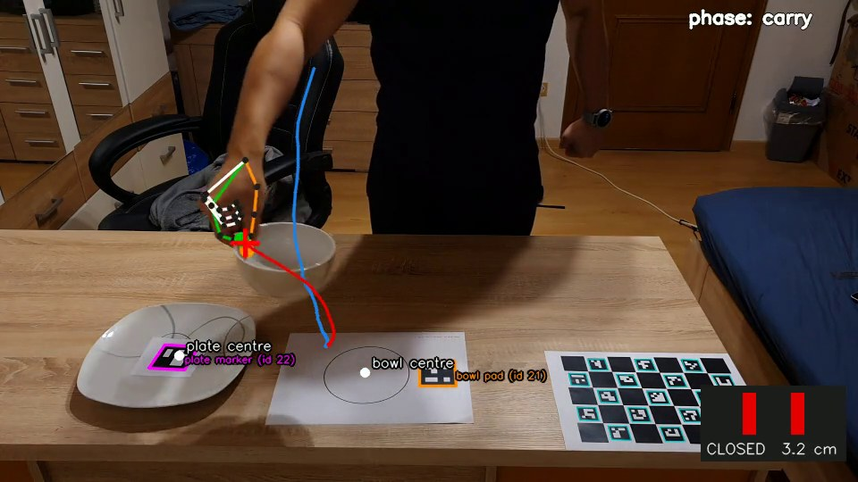
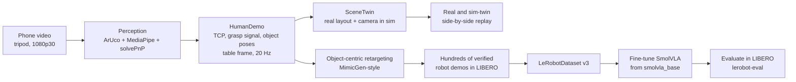
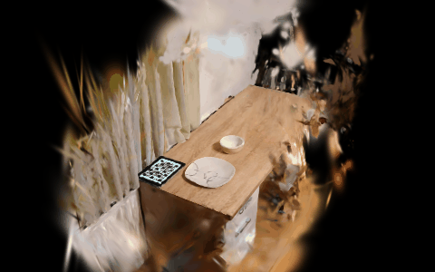
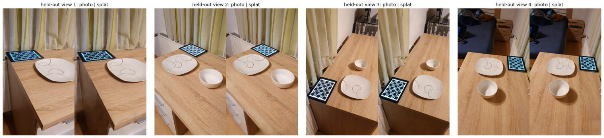
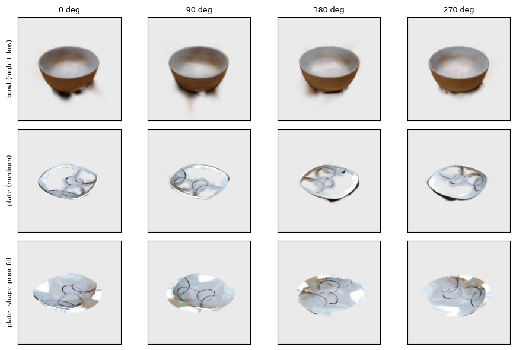
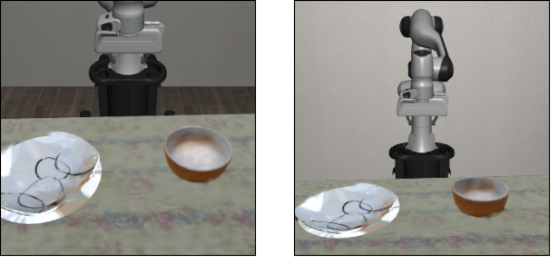

# hurobo: from phone video of a human hand to a robot policy in simulation

This project trains a small robot foundation model (SmolVLA, 450M parameters) with data from phone videos of a human hand. The policy runs on a Franka Panda arm in the LIBERO simulator.

The robot is not teleoperated. The simulated table is a copy of the real table. The Panda repeats what the human hand did on it.

The first experiment, how to record for it and what the pipeline does with the clips: [docs/experiment_scaled_native.md](docs/experiment_scaled_native.md).

**Question.** Can human videos improve a small VLA on a new layout and a new object?

**Main concept.** The video is a motion-capture device. Markers and a hand tracker turn each clip into a table-frame hand path. The path is retargeted to many simulated object poses, and only successful runs become training data. SmolVLA never sees a real pixel (section 3, solution 4). A digital twin and Gaussian-splat scans of the real scene are added for visuals.

**Current state.** The perception, twin, retargeting and generation code is built and tested on stand-in hand paths. One real clip is processed (below); its robot replay timed out. The 15 to 20 clip session is not recorded, and no policy is trained on my data yet. What exists as a measurement: how the two public SmolVLA LIBERO checkpoints behave when the layout or the object size changes ([section 9](#9-results)). Details: [section 7](#7-status-and-todo).



*Real clip `test_03`, cut to one grasp cycle: marker outlines (plate id 22, bowl pad id 21, ChArUco board), hand skeleton, projected TCP path (red: carried, blue: path so far) and the gripper symbol from the pinch aperture. Notebook [11_recorded_dataset_and_replay](examples/11_recorded_dataset_and_replay.ipynb).*


---

## 1. Goal, constraints, limitations

**Goal.** Train a small VLA only with data that I recorded with a phone. The policy must do a pick-and-place task (bowl onto plate) in simulation.

**Resource constraints**

| Constraint | Effect on the design |
|---|---|
| One 16 GB GPU | Use a 450M-parameter VLA in bf16. Do not use 3B or 7B models. Use ACT as a fallback. |
| NVIDIA driver 560.35 (CUDA 12.6 maximum) | Install PyTorch from the cu126 index. Isaac Sim 5 and PolaRiS do not work. Use MuJoCo. |
| About 7 days. Long work days only on Friday to Sunday. | Start long jobs (generation, training) at the end of a short session. Each block has a gate and a fallback. |
| The data must come from me, with a phone | About 15 third-person clips on a tripod. One camera. No depth sensor. No motion-capture glove. |
| Public repository | Do not commit large files. The repository contains scripts and a link to the dataset on the Hugging Face Hub. |

**Limitations**

- **No physical robot.** The policy is evaluated in simulation only. This project makes no claim about real-world transfer.
- **Distribution shift.** The data comes from a human hand in a real room. The policy runs on a Panda in a rendered scene. The gap has four parts: appearance (real pixels and rendered pixels), embodiment (hand and parallel-jaw gripper), timing and dynamics, and object geometry. Section 3 describes how each approach treats the gap.
- **One camera, markers needed.** The metric hand pose comes from MediaPipe, `solvePnP` and ArUco markers on the table and objects. This limits where and how I can record.
- **Simplified orientation.** Retargeted grasps use a fixed top-down gripper orientation. The yaw comes from the object.
- **One task family.** Bowl on plate. This project makes no claim for other tasks.

---

## 2. Storyline



1. **Record** human demonstrations with a tripod. Use a ChArUco-calibrated camera. Put printed ArUco markers on the table, bowl and plate.
2. **Extract** a metric TCP trajectory (midpoint of thumb tip and index tip), a grasp signal from the pinch, and the object poses. Express all of them in the table frame.
3. **Build a digital twin** of the real layout and camera viewpoint in the simulator (`SceneTwin`). Replay the human motion on the Panda. The side-by-side video of the real clip and the sim twin is the minimum deliverable.
4. **Multiply the data.** Split each human demo into object-relative segments. Retarget the segments to many simulated object poses. Run them. Keep only the successful runs.
5. **Train** SmolVLA from `lerobot/smolvla_base`. This model has not seen LIBERO. Use only the generated data. Then each success comes from this pipeline.
6. **Evaluate** with `lerobot-eval`. Report the success rate with a confidence interval and with baselines.

---

## 3. Real2sim: how to close the gap

The central question: how much of the real world must the simulator copy so that a policy trained from human video works in the simulator? This section compares four solutions. They go from "copy nothing" to "copy the whole scene".

### Solution 1: teleoperate directly in the simulator

Collect the data in the simulator. Control the Panda with a tracked hand or with the keyboard.

- **Distribution shift:** none for visuals. Training and test use the same renderer.
- **Problem:** it is hard to control a 7-DoF arm precisely with a tracked hand or a keyboard. The demos are slow, jerky and few. The real recording has no role. This breaks the challenge rule that the recorded real data must be used.
- **Status:** built as a tool (`teleop.py`, `13_teleop.py`, notebook 05). It is for validation and debugging. It is not the data source.

### Solution 2: scan the real objects and add them to the simulator

Reconstruct the bowl and plate from a phone orbit video. Place them in the LIBERO scene.

- **Idea:** the objects are what the policy touches. If they look and collide like the real objects, the most important part of the visual gap closes. The rest of the scene stays synthetic.
- **Pipeline:** orbit video → COLMAP poses (`pycolmap`) → Gaussian splat (`gsplat`) → metric alignment with a ChArUco board → collision mesh (splat → mesh → convex pieces) → attach to the LIBERO bodies.
- **Remaining shift:** table, background, lighting and camera come from LIBERO.

### Solution 3: scan the whole scene and add it to the simulator

Reconstruct the full table scene as a splat. Render the simulator from the real camera viewpoint. Composite the robot into the image by depth.

- **Distribution shift:** the smallest visual gap of the four. The rendered view is similar to the real view.
- **Cost:** it needs a good scan, careful metric and frame alignment, GPU time for splat training, and compositing code. The physics still come from LIBERO. A rendered scan is only a picture. It does not make the dynamics equal to the real dynamics.

### Solution 4: use real objects with the same size as the LIBERO objects (simplest)

Select ready LIBERO objects (bowl, plate). Find real objects with the same size. Use them for the hand data collection.

- **How:** read the bounding box of each LIBERO object asset. Buy or find real objects that match the width, depth and height. Put the markers on them. Record the hand demos as usual.
- **Advantage:** no scanning, no reconstruction and no extra GPU work. The grasp height, the aperture and the carry path from the human demo are correct for the simulated object.
- **Disadvantage:** there is a distribution shift between the objects and the scene. The real objects match the size, but not the texture, color or material. The real table, the background and the lighting do not match LIBERO. This shift is small for a motion-only pipeline, because the policy does not see real pixels. It is large for any approach that uses real pixels.

### What this project does

| Step | Approach | Status |
|---|---|---|
| Baseline | **Motion-only retargeting with size-matched objects (Solution 4).** The video is a motion-capture device. Only a few object-relative numbers cross from real to sim: approach direction, grasp height, lift, carry path, place offset, release timing. SmolVLA does not see a real pixel. | core path |
| Main visual | **SceneTwin:** copy the real object layout and camera pose into the simulator. Replay. Render from the same viewpoint next to the real clip. | built, checked on stand-in data |
| Stretch | **Solutions 2 and 3 with Gaussian splats:** attach scanned objects (and scene) to the LIBERO bodies. Composite with the mesh robot by depth. | pipeline built, checked on stand-in scans and two real phone clips of one bowl (COLMAP's defaults registered 39 of 120 frames of one clip, so SfM uses a lowered SIFT threshold; see the [design log](docs/design_decisions.md)), time-gated |

The baseline avoids the visual domain gap. It does not close the gap. Splat-based real2sim reduces the visual gap for illustration. A real-robot validation is outside this challenge.

### What the splat route has produced so far

All of this comes from my own phone clips of one table, one bowl and one plate. It is for looks only: it does not train or evaluate a policy. Scan details and limits: [D-001 to D-009 in the design log](docs/design_decisions.md).

**The whole scene** (table, background, bowl, plate) in one splat, from two clips with a ChArUco board on a tablet as the metric frame. The animation is a camera sweep over the Gaussians, cut to the box x −0.39..1.66, y −0.79..0.61, z −2.71..1.01 m (table frame, tabletop at z = 0). The strip below compares phone photo (left) and splat render (right) from four held-out camera poses.





Interactive 3D view (orbit, pan, crop box; GitHub cannot run it, so open it locally):

```bash
uv run python -c "from pathlib import Path; from hurobo.utils.viewer import write_splat_viewer; write_splat_viewer(Path('data/splats/table_zoom_02_03_scene.ply'), Path('data/viewer/table_zoom_02_03_scene'))"
uv run python -m http.server 8791 -d data/viewer/table_zoom_02_03_scene   # then open http://localhost:8791/
```

[07_whole_scene](examples/07_whole_scene.ipynb) shows the same splat as a plotly 3D view with a layer switch (whole scene, table, background, plate, bowl) and writes the sweep above.

**The scanned bowl and plate**, rendered from four sides (the plate's last row has its gaps closed with a measured shape prior, [D-009](docs/design_decisions.md); the rim and profile there come from the prior, not from the scan):



**Bowl and plate inside the LIBERO scene**, scaled to the measured diameters (bowl 13.8 cm, plate 25.5 cm) and composited with the mesh robot by depth. The table cloth is still LIBERO's. The splats change only the appearance; physics and collisions are LIBERO's own bodies.



Reproduce: [01_splats_and_scans](examples/01_splats_and_scans.ipynb), part 3 (needs `data/splats/` and `data/scans/` from `scripts/09_scan_object.py` and `scripts/15_scan_clips.py`, and a GPU).

---

## 4. Frameworks and models

| Component | Choice | Reason |
|---|---|---|
| Simulator and benchmark | **LIBERO** (`hf-libero`, on robosuite and MuJoCo) | It is the simulator in the challenge brief. It installs with pip. It has a Panda arm. `lerobot-eval` supports it. Generation and evaluation use one env wrapper, so observations and actions match. |
| Policy framework | **LeRobot** (0.6.1 or later) | It gives `lerobot-train`, `lerobot-eval`, the LIBERO wrapper and the LeRobotDataset v3 format. |
| VLA | **SmolVLA** (`lerobot/smolvla_base`, 450M) | It fits the 16 GB GPU in bf16. The checkpoint has not seen LIBERO, so prior task knowledge does not confuse the result. |
| Fallback policy | **ACT** | It trains from scratch in about one hour. It is strong on single-task LIBERO. |
| Hand tracking | **MediaPipe Hand Landmarker** | It runs on CPU. It gives 2D landmarks and metric world landmarks. `solvePnP` converts them to a metric hand pose without a depth sensor. |
| Frames and objects | **OpenCV ArUco** | It gives 6-DoF poses without machine learning. It is robust. The markers do not appear in the simulator. |
| Intrinsics | **ChArUco** calibration (OpenCV) | Correct PnP and the simulator camera FOV need the intrinsics. |
| Scene reconstruction | **pycolmap** (SfM) and **gsplat** (Gaussian splatting) | They estimate poses and train a splat from a phone orbit video. They run on this GPU with the cu126 build. |
| Splat rendering | **DISCOVERSE `gaussian-renderer`** | It is a MuJoCo-native splat renderer. It composites with mesh geometry by depth. |
| Collision geometry | **open3d** and **CoACD** | They convert a splat to a surface mesh and convex pieces. Scanned objects then have a solid body. |
| Tooling | **uv**, **ruff**, **pytest**, Jupyter and **plotly** | Reproducible environment, formatting and lint, tests, interactive 3D views. |

Related work (full citations in [section 10](#10-references)): MimicGen [4] (used as a concept), HaWoR [5] (considered and not used, because the camera is fixed), NovaFlow [6], Video2Sim2Real [7], Phantom [8], PolaRiS [9] and RoboGSim [10] (human-video and real2sim ideas, not used as code).

NovaFlow [6] is the closest in spirit and differs in the source of the motion. It turns a video made by a generative model into 3D object flow and executes that flow on a robot without any training. This project uses a real video of a human hand, retargets the hand path to many simulated object poses, and trains SmolVLA on the verified runs. I do not reuse NovaFlow's code or models, and I have not compared against it.

---

## 5. Hardware and software setup

**Capture hardware**

| | |
|---|---|
| Camera | Samsung Galaxy S10e on a tripod (1080p30, stabilization off, focus and exposure locked) |
| Recording trigger | CMF Watch Pro 2 smartwatch, to start and stop the recording |

**Software**

- Python 3.12, managed with **uv only**. Always use `uv run ...`. Do not use bare `python`.
- PyTorch from the CUDA 12.6 index. Only `opencv-contrib-python` is installed. `opencv-python` is overridden out, because it replaces the `cv2` module of `mediapipe`.
- Headless rendering with `MUJOCO_GL=egl`.

```bash
git clone <this repo> && cd hurobo
cp .env.example .env
uv sync
uv run python -c "import torch; print(torch.__version__, torch.cuda.is_available())"   # expect +cu126, True
MUJOCO_GL=egl uv run python scripts/00_check_env.py                                      # builds the LIBERO env, saves a frame
uv run pytest
```

Notes:

- Do not download `HuggingFaceVLA/libero` (70 GB). Use `lerobot/libero` (1.9 GB) if you need reference data.
- If LIBERO asks for `~/.libero/config.yaml` on the first run, create the file before you start.
- If torchcodec fails to decode video, use `--dataset.video_backend=pyav`.
- Marker IDs: ChArUco uses IDs 0 to 16 of `DICT_4X4_50`. Table, bowl and plate markers use IDs 17 or higher.

---

## 6. Workspace structure

```
hurobo/
├── README.md
├── pyproject.toml  uv.lock  ruff.toml  .env.example
├── src/hurobo/
│   ├── camera.py, camera_source.py   # intrinsics, ChArUco calibration, webcam / file / stream sources
│   ├── markers.py                    # ArUco poses: T_cam_table, T_table_bowl, T_table_plate
│   ├── hand.py, live_hand.py         # MediaPipe + PnP hand TCP and pinch aperture (offline / live)
│   ├── demo.py, extract.py           # HumanDemo, grasp segmentation, DemoExtractor + QC report
│   ├── human_dataset.py, recorder.py # HumanDemo → LeRobotDataset v3
│   ├── twin.py, sim.py               # SceneTwin, LIBERO wrapper
│   ├── control.py                    # waypoints → clipped 7-D delta actions
│   ├── teleop.py, teleop_app.py, live.py, props.py   # hand/keyboard teleop of the Panda, live window, grasp cube
│   ├── scan.py, scan_sweep.py, splat.py, collider.py # orbit video → splat → composite → collision mesh; scan parameter sweep
│   ├── real_setup.py, object_scale.py, scaled_native.py # measurements.yaml, MJCF scaling, E1 scene (scaled bowl and plate)
│   ├── capture_plan.py, recording.py # phone pose search, layouts, markers, capture check
│   ├── retarget.py, generate.py, reach.py # human demo → robot demo from home, dataset generation, reach map
│   └── utils/                        # transforms, signal, video, plotting, viewer, synthetic, notebook
├── scripts/                          # thin CLIs: NN_name.py
├── examples/                         # one notebook for each capability (section 8)
├── docs/                             # scanning_guide.md, camera_sources.md, design_decisions.md
├── tests/                            # pytest
└── data/                             # not in git: raw clips, intrinsics, scans, splats, datasets
```

Rules for the code:

- Each module has one responsibility. Scripts only parse arguments and call objects.
- Each pose variable has its frame in its name (`T_cam_table`, `p_tcp_table`).
- Notebooks contain no reusable logic.

---

## 7. Status and TODO

Legend: ✅ built and tested on stand-in data, 🟡 partly done, ⬜ not started.

| Area | Item | Status |
|---|---|---|
| Setup | uv environment, cu126 torch, LIBERO renders a frame | ✅ |
| Objects | Read the bounding boxes of the LIBERO bowl and plate assets | ✅ (bowl 11.2 cm, plate 13.8 cm; scaled x1.23 and x1.86 to the measured objects, D-010) |
| Objects | Find real objects with the same size. Attach ArUco markers. | ⬜ |
| Capture | Phone calibration (intrinsics files for S24 and S10e exist) | 🟡 |
| Capture | **15 to 20 real third-person demo clips**, ChArUco board as the table frame, bowl pad and plate marker. Plan, markers and capture check exist ([guide](docs/experiment_scaled_native.md)) | 🟡 tooling ✅, recording ⬜ |
| Capture | Slow orbit of table, bowl and plate with ChArUco board (for scanning) | ⬜ |
| Perception | ArUco poses, MediaPipe + PnP hand TCP, grasp segmentation, QC report | ✅ |
| Perception | Run on real clips. Check the depth anchor correction. | ⬜ |
| Dataset | `HumanDemo` → LeRobotDataset v3 export and reload | ✅ |
| Sim | `SceneTwin`: real layout and camera in the simulator | ✅ (real clip needed) |
| Sim | Real and sim-twin side-by-side replay (`03_replay.py`, empty now) | ⬜ |
| Teleop | Hand-clip and keyboard teleop of the Panda, live window | ✅ |
| Retargeting | `ObjectCentricRetargeter`, fixed top-down orientation, robot from the home pose | ✅ on made-up hand paths ([D-010](docs/design_decisions.md)); no real clip yet |
| Retargeting | Tune grasp height and offset once. Measure success on 20 rollouts. | ⬜ |
| Generation | `DemoGenerator` and `04_generate_dataset.py` (success only, one process) | ✅ on made-up hand paths; multiprocess not done |
| Training | `05_train.sh`. ACT fallback (about 1 h), then SmolVLA fine-tune. | ⬜ |
| Evaluation | N = 50 with Wilson CI. Baselines: zero-shot, open-loop replay. `lerobot-eval` rebuilds the stock scene, so a loop through `ScaledNativeScene.reset` is needed | ⬜ |
| Figures | GIFs, 3D trajectory plot (human TCP and robot EEF), data-multiplier curve, one failure case | ⬜ |
| Stretch | Splat scan of the real bowl, plate and table. Composited frames. Collision mesh. | 🟡 pipeline built. Real scans of the bowl, the plate and the whole table scene exist (metric ChArUco frame for the scene, [D-009](docs/design_decisions.md); lowered SIFT threshold and floor-based crop, [D-001, D-004](docs/design_decisions.md)), and the scanned bowl and plate are composited into LIBERO ([gallery](#what-the-splat-route-has-produced-so-far)). The plate has gaps; the filled version uses a shape prior. One scene, two clips each. The scene splat is not in LIBERO yet, and the collision mesh is not wired into the experiment. |
| Stretch | Second camera view for stereo, only if monocular depth fails | ⬜ |
| Submission | Fresh-clone test, results table, honest "what did not work", public repository | ⬜ |

If time is short, cut in this order: splat stretch, robot overlay, SmolVLA (keep ACT), data-multiplier plot. Never cut the twin side-by-side or this README.

---

## 8. Notebooks

The notebooks are in [examples/](examples/). Each notebook runs from top to bottom and stores its outputs. Each notebook calls `src/hurobo` and contains no reusable logic.

| Notebook | Content |
|---|---|
| [01_splats_and_scans](examples/01_splats_and_scans.ipynb) | Splats end to end: interactive 3D view, scan pipeline (orbit video → COLMAP → object frame, best scans), splats composited into LIBERO by depth. |
| [02_frames_and_calibration](examples/02_frames_and_calibration.ipynb) | Frame conventions, intrinsics → MuJoCo FOV, ChArUco board, on-screen marker sheet, grasp segmentation. |
| [03_hand_tracking](examples/03_hand_tracking.ipynb) | MediaPipe + PnP hand TCP, pinch-aperture step-through, ArUco poses against ground truth, `DemoExtractor` QC report. |
| [04_lerobot_recording](examples/04_lerobot_recording.ipynb) | `HumanDemo` → LeRobotDataset v3 export and reload: schema, video, state and action, sidecar file. |
| [05_teleop](examples/05_teleop.ipynb) | Hand-clip teleoperation of the LIBERO Panda: table-to-world mapping, tracking error, cube spawned on grasp, scripted keyboard control. |
| [06_scan_parameter_sweep](examples/06_scan_parameter_sweep.ipynb) | How SfM settings, matching mode, keyframe spacing and training length change a real phone scan (registration, orbit coverage, held-out PSNR), and three ways of cropping the object compared against an independent reference. Real clip, not committed. |
| [07_whole_scene](examples/07_whole_scene.ipynb) | The whole table scan merged into one splat: interactive 3D view with a layer switch, photo and splat renders from the phone's camera path, a browser viewer with a crop box, still 3D views of the cut scene and the README sweep. |
| [08_scaled_native_experiment](examples/08_scaled_native_experiment.ipynb) | Experiment E1: real-size bowl and plate in LIBERO, the recording plan (phone pose, layouts, markers, commands), human demo to robot demo from the home pose, success rate of retargeted rollouts. Hand input is made up. |

Most notebooks use **stand-in data** (dummy scans, a stand-in hand clip with synthetic markers). The real capture session is not processed yet; notebook 06 is the exception and reads results from a real phone clip of a bowl. Each notebook states this in its introduction.

```bash
uv run jupyter lab examples/
MUJOCO_GL=egl uv run jupyter nbconvert --to notebook --execute --inplace examples/01_splats_and_scans.ipynb
```

---

## 9. Results

### Pretrained SmolVLA checkpoints in five scenes

No training by me. The two most-liked LIBERO checkpoints on the Hub drive the Panda in the simulator; success is LIBERO's own check. Same layouts for both checkpoints, 300 steps, new action chunk every 10 steps, 10 episodes per cell (one cell has 8). Source: [09_smolvla_benchmark](examples/09_smolvla_benchmark.ipynb) and [D-011](docs/design_decisions.md).

| Scene | What changes | `lerobot/smolvla_libero` | `HuggingFaceVLA/smolvla_libero` |
|---|---|---|---|
| 1. Stock | LIBERO's own scene and start positions | 10/10 | 8/10 |
| 2. Cleared, LIBERO layout | Other objects removed; bowl and plate start where LIBERO puts them | 6/10 | 3/10 |
| 3. Cleared, new layout | Other objects removed; bowl and plate at random positions | 0/10 | 0/10 |
| 4. Real size, LIBERO layout | Bowl and plate at the measured real sizes (plate 1.86x wider); LIBERO's placement | 0/10 | 0/8 |
| 5. Real size, new layout | Real sizes at random positions: the target scene of my experiment | 0/10 | 0/10 |

Reading: the success of both checkpoints depends strongly on where the objects start and on their size. A new layout alone takes the better checkpoint from 6/10 to 0/10, and real-size objects give 0 even on LIBERO's own layout. Removing the other objects already lowers success (scene 1 to 2). With 10 episodes per cell the 95% Wilson interval of 0/10 is 0 to 28%, so small differences mean nothing. The cause is not established: candidates not yet tested are the fixed start positions the checkpoints saw in training and the removed distractors. This is why the question above is open: a policy trained on one fixed layout does not carry over to a new layout or a new object, and whether human video fixes that is what the experiment below is for.

### Planned experiment

There are no results for a policy trained on my data yet. The planned experiment (target task, N = 50 episodes, Wilson 95% CI):

| Policy | Trained on | Success |
|---|---|---|
| `smolvla_base` zero-shot | nothing from LIBERO | pending |
| Open-loop retarget replay | one human demo for each rollout, no learning | pending |
| **SmolVLA (ours)** | generated demos from my phone video only | pending |
| ACT (ours) | same data | pending |

This table will contain only numbers from runs that were executed. Failed runs are included.

---

## 10. References

Papers behind the components and related work in section 4. The status of each (as-is, configured, modified, rejected) is in the [design log](docs/design_decisions.md). Software without a paper is listed under "Software".

### Related work

1. M. Shukor et al. **SmolVLA: A Vision-Language-Action Model for Affordable and Efficient Robotics.** 2025. [arXiv:2506.01844](https://arxiv.org/abs/2506.01844)
2. B. Liu, Y. Zhu, C. Gao, Y. Feng, Q. Liu, Y. Zhu, P. Stone. **LIBERO: Benchmarking Knowledge Transfer for Lifelong Robot Learning.** NeurIPS Datasets and Benchmarks, 2023. [arXiv:2306.03310](https://arxiv.org/abs/2306.03310)
3. T. Z. Zhao, V. Kumar, S. Levine, C. Finn. **Learning Fine-Grained Bimanual Manipulation with Low-Cost Hardware** (ACT). RSS, 2023. [arXiv:2304.13705](https://arxiv.org/abs/2304.13705)
4. A. Mandlekar, S. Nasiriany, B. Wen, I. Akinola, Y. Narang, L. Fan, Y. Zhu, D. Fox. **MimicGen: A Data Generation System for Scalable Robot Learning using Human Demonstrations.** CoRL, 2023. [arXiv:2310.17596](https://arxiv.org/abs/2310.17596)
5. J. Zhang, J. Deng, C. Ma, R. A. Potamias. **HaWoR: World-Space Hand Motion Reconstruction from Egocentric Videos.** CVPR, 2025. [arXiv:2501.02973](https://arxiv.org/abs/2501.02973)
6. H. Li, L. Sun, Y. Hu, D. Ta, J. Barry, G. Konidaris, J. Fu. **NovaFlow: Zero-Shot Manipulation via Actionable Flow from Generated Videos.** 2025. [arXiv:2510.08568](https://arxiv.org/abs/2510.08568)
7. J. Qiu, Y. Han et al. **Video2Sim2Real: Full-Stack Autonomous Dexterous Skill Acquisition from a Single Human Video.** 2026. [arXiv:2606.08828](https://arxiv.org/abs/2606.08828)
8. M. Lepert, J. Fang, J. Bohg. **Phantom: Training Robots Without Robots Using Only Human Videos.** CoRL, 2025. [arXiv:2503.00779](https://arxiv.org/abs/2503.00779)
9. A. Jain, M. Zhang et al. **PolaRiS: Scalable Real-to-Sim Evaluations for Generalist Robot Policies.** 2025. [arXiv:2512.16881](https://arxiv.org/abs/2512.16881)
10. X. Li, J. Li et al. **RoboGSim: A Real2Sim2Real Robotic Gaussian Splatting Simulator.** 2024. [arXiv:2411.11839](https://arxiv.org/abs/2411.11839)

### Components

11. J. Wu et al. **DISCOVERSE: Efficient Robot Simulation in Complex High-Fidelity Environments.** IROS, 2025. [arXiv:2507.21981](https://arxiv.org/abs/2507.21981)
12. B. Kerbl, G. Kopanas, T. Leimkühler, G. Drettakis. **3D Gaussian Splatting for Real-Time Radiance Field Rendering.** ACM TOG (SIGGRAPH), 2023. [arXiv:2308.04079](https://arxiv.org/abs/2308.04079)
13. V. Ye et al. **gsplat: An Open-Source Library for Gaussian Splatting.** 2024. [arXiv:2409.06765](https://arxiv.org/abs/2409.06765)
14. J. L. Schönberger, J.-M. Frahm. **Structure-from-Motion Revisited** (COLMAP). CVPR, 2016. [PDF](https://openaccess.thecvf.com/content_cvpr_2016/html/Schonberger_Structure-From-Motion_Revisited_CVPR_2016_paper.html)
15. F. Zhang et al. **MediaPipe Hands: On-device Real-time Hand Tracking.** 2020. [arXiv:2006.10214](https://arxiv.org/abs/2006.10214)
16. X. Wei et al. **Approximate Convex Decomposition for 3D Meshes with Collision-Aware Concavity and Tree Search** (CoACD). SIGGRAPH, 2022. [arXiv:2205.02961](https://arxiv.org/abs/2205.02961)

### Software

- [LeRobot](https://github.com/huggingface/lerobot) (Hugging Face): training, evaluation and the LeRobotDataset v3 format.
- [robosuite](https://robosuite.ai) and [MuJoCo](https://mujoco.org): the physics and rendering under LIBERO.
- [OpenCV](https://opencv.org) (ArUco, ChArUco, `solvePnP`) and [Open3D](https://www.open3d.org).

Author lists marked "et al." are shortened; the arXiv page of each entry has the full list. Every title and arXiv number was checked against its arXiv listing. I read the abstracts only, not the full papers, for entries 6 to 11.
