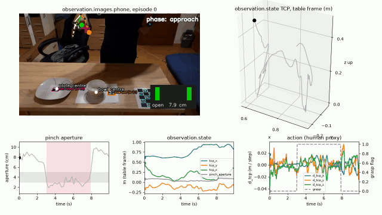
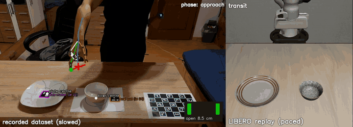
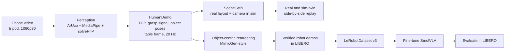

# hurobo: from phone video of a human hand to a robot policy in simulation

A small robot foundation model (SmolVLA, 450M parameters) is trained with phone videos of a human hand. The policy controls a Franka Panda arm in the LIBERO simulator. The robot is not teleoperated.

**Question.** Can human videos improve a small VLA on a new layout and a new object?

**Concept.** The video is a motion-capture device. Markers and a hand tracker change each clip into a hand path in the table frame. The path is retargeted to many simulated object poses. Only successful runs become training data. SmolVLA never sees a real pixel.

**Scope.** Simulation only. One task (bowl onto plate). One seed. N = 20. Several baselines are not run yet. See [Open points](#open-points).

## Results

Scaled LIBERO scene (real-size bowl and plate, other objects removed). 20 held-out layouts (100 to 119). The same layouts are used for each policy. The 95 % interval is a Wilson interval.

| Policy | Trained on | Success | 95 % CI |
|---|---|---|---|
| `HuggingFaceVLA/smolvla_libero` | Pretrained. No training done here. | 0/20 | 0 to 16 % |
| `lerobot/smolvla_libero` | Pretrained. No training done here. | 0/20 | 0 to 16 % |
| **Ours**, `smolvla_base` init | 100 generated episodes from 12 phone clips, 3000 steps | 3/20 | 5 to 36 % |
| **Ours**, `smolvla_libero` init | The same 100 episodes, the same settings | **14/20** | 48 to 85 % |
| `smolvla_base` zero-shot | - | not run | |
| Open-loop retarget replay | - | not run | |
| Same pipeline, synthetic path (no human data) | - | not run | |
| ACT | The same 100 episodes | not run | |

<p align="center">
  
</p>

How to read this table:

- The best checkpoint of each run was selected on layouts 0 to 9. It was then tested on layouts 100 to 119.
- The layouts come from the same generator as the training data. The "new object" is the LIBERO bowl and plate, scaled to the real size.
- The `smolvla_base` run is short (about 1.35 epochs). Its low score can be an effect of under-training. This is not tested.
- No condition without human data was run. The table does **not** show that human video is the cause of the result.
- The pretrained checkpoints depend strongly on object position and size (for example 6/10 on LIBERO's layout, 0/10 on a new layout). Details: [docs/results.md](docs/results.md).

A critical review of these limits is in [docs/review.md](docs/review.md).

## Examples

<p align="center">
  
</p>

*One real clip, cut to one grasp cycle and read back from the LeRobot dataset. Notebook [11_recorded_dataset_and_replay](examples/11_recorded_dataset_and_replay.ipynb).*

<p align="center">
  
</p>

*The same clip (left) and the robot replay in the scaled LIBERO scene (right). The replay did not complete the task. It timed out.*

<p align="center">
  
  
  
</p>

*Three generated episodes. Agent view on top, wrist view below.*

## How it works



1. **Record.** A tripod and a calibrated phone. ArUco markers on the table, bowl and plate.
2. **Extract.** A metric hand path (midpoint of thumb tip and index tip), a grasp signal from the pinch, and the object poses. All values are in the table frame.
3. **Twin.** The real layout and camera are rebuilt in the simulator. The Panda replays the human motion.
4. **Multiply.** Each demo is split into object-relative segments. The segments are retargeted to random bowl and plate positions. Only successful runs are kept.
5. **Train.** SmolVLA is fine-tuned on the generated data only.
6. **Evaluate.** `lerobot-eval` rules, with a success rate and a confidence interval.

**Generated data.** 12 of the 26 clips were usable. `scripts/04_generate_dataset.py` made 170 rollouts and kept 100 successes (59 %). Of the 70 failures, 37 never lifted the bowl and 33 timed out. Episodes are 224 to 663 steps long (median 321.5). No length filter was applied. 5 of the 12 clips pass the cleaning only with the release-distance gate waived. Details: [docs/pipeline_and_dataset.md](docs/pipeline_and_dataset.md).

## Real2sim: what is copied

| Option | Idea | Status |
|---|---|---|
| 1. Teleoperate in the simulator | No real data is used. | Debug tool only |
| 2. Scan the objects | Splats of the bowl and plate in the simulator. | Stretch |
| 3. Scan the whole scene | Render the simulator from the real camera view. | Stretch |
| **4. Size-matched objects** | Real objects have the same size as the LIBERO objects. Only object-relative motion crosses to the simulator. | **Core path** |

The core path does not close the visual gap. It avoids it, because the policy sees no real pixels. Splat scans are visual only and do not train or test a policy. Details: [docs/real2sim_options.md](docs/real2sim_options.md) and [docs/extensions.md](docs/extensions.md).

## Design choices: what worked and what did not

**Choices**

- **Motion only.** The video gives object-relative motion. The simulator gives exact poses, geometry and appearance. This avoids the real-to-sim pixel gap. The cost: the human video gives only the path shape and timing. The robot sets grasp height, yaw and release height.
- **Real-size objects.** The LIBERO bowl and plate are scaled to the measured real size (bowl x1.23, plate x1.86). The human grasp height and carry path then fit the simulated objects.
- **Success filter.** Only rollouts that LIBERO accepts become training data.
- **Libraries.** LIBERO, LeRobot, MediaPipe, OpenCV ArUco. See [docs/frameworks_and_references.md](docs/frameworks_and_references.md). Each change to an upstream default is in [docs/design_decisions.md](docs/design_decisions.md).

**What worked**

- Hand tracking with markers gives a usable metric path. 12 of 26 clips passed cleaning.
- The generator makes 100 successful episodes from 170 rollouts.
- Fine-tuning from `smolvla_libero` reaches 14/20 on held-out layouts. The pretrained checkpoints reach 0/20.

**What did not work, or is not shown**

- The robot replay of the first clip timed out.
- The `smolvla_base` init reached only 3/20. The cause is not tested (possible under-training).
- COLMAP defaults registered only 39 of 120 frames of one bowl clip. A lowered SIFT threshold fixed this ([D-001](docs/design_decisions.md)).
- The splat route did not feed the policy. It is visual only.
- The faster generation method was not used for training. Its gain comes mostly from three simple filters ([docs/extensions.md](docs/extensions.md)).
- The data's own contribution is not isolated ([docs/review.md](docs/review.md)).

## Limitations

- **No physical robot.** All results are from simulation.
- **One camera, markers needed.** The hand pose uses MediaPipe, `solvePnP` and ArUco markers. This limits where the recording can be made.
- **Simple grasp.** The gripper orientation is fixed top-down. The yaw comes from the object.
- **One task family.** Bowl on plate. One session, one person, one object pair.
- **Marker size not measured.** Object poses can be scaled wrongly.

## Open points

- Baselines: zero-shot, open-loop replay, synthetic path (no human data), ACT.
- N = 50, more seeds, a longer `smolvla_base` run.
- Scene splat and collision meshes in LIBERO.
- Training on the faster generation method ([docs/extensions.md](docs/extensions.md)).

The full list is in [docs/status.md](docs/status.md).

## Run it

```bash
git clone <this repo> && cd hurobo
cp .env.example .env
uv sync
uv run python -c "import torch; print(torch.__version__, torch.cuda.is_available())"   # expect +cu126, True
MUJOCO_GL=egl uv run python scripts/00_check_env.py                                      # builds the LIBERO env, saves a frame
uv run pytest
```

Use `uv run` for all commands. Do not use bare `python`. Raw clips, datasets and checkpoints are not in git. More notes (hardware, gotchas, workspace structure): [docs/setup.md](docs/setup.md). Notebooks: [docs/notebooks.md](docs/notebooks.md).

## Documentation

| File | Content |
|---|---|
| [docs/review.md](docs/review.md) | What the results do and do not show. Missing controls. |
| [docs/results.md](docs/results.md) | Pretrained checkpoints in five scenes. Fine-tune checkpoints. Held-out comparison. |
| [docs/pipeline_and_dataset.md](docs/pipeline_and_dataset.md) | Pipeline steps, constraints, limitations, the first generated dataset. |
| [docs/real2sim_options.md](docs/real2sim_options.md) | The four real2sim options and their trade-offs. |
| [docs/extensions.md](docs/extensions.md) | Gaussian-splat scans. Faster demo generation (MimicGen-style). |
| [docs/experiment_scaled_native.md](docs/experiment_scaled_native.md) | How to record clips and how the pipeline uses them. |
| [docs/scanning_guide.md](docs/scanning_guide.md) | How to scan an object or a scene with a phone. |
| [docs/camera_sources.md](docs/camera_sources.md) | Webcam, file and stream sources. |
| [docs/design_decisions.md](docs/design_decisions.md) | Components taken from existing work. Changes to defaults, with evidence. |
| [docs/frameworks_and_references.md](docs/frameworks_and_references.md) | Frameworks, models, related work and papers. |
| [docs/setup.md](docs/setup.md) | Hardware, software, notes and workspace structure. |
| [docs/status.md](docs/status.md) | Status table and TODO. |
| [docs/notebooks.md](docs/notebooks.md) | One notebook for each capability. |
