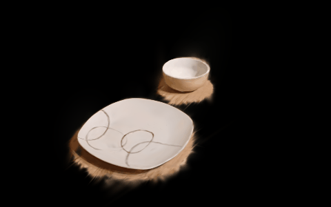

# Extensions: splat scans and faster demo generation


### What the splat route has produced so far

All of this comes from my own phone clips of one table, one bowl and one plate. It is for looks only: it does not train or evaluate a policy. Scan details and limits: [D-001 to D-009 in the design log](design_decisions.md).

**The whole scene** (table, background, bowl, plate) in one splat, from two clips with a ChArUco board on a tablet as the metric frame. The animation is a camera sweep over the Gaussians, cut to the box x −0.39..1.66, y −0.79..0.61, z −2.71..1.01 m (table frame, tabletop at z = 0). The strip below compares phone photo (left) and splat render (right) from four held-out camera poses.

<p align="center">
  
</p>

Interactive 3D view (orbit, pan, crop box):

```bash
uv run python -c "from pathlib import Path; from hurobo.utils.viewer import write_splat_viewer; write_splat_viewer(Path('data/splats/table_zoom_02_03_scene.ply'), Path('data/viewer/table_zoom_02_03_scene'))"
uv run python -m http.server 8791 -d data/viewer/table_zoom_02_03_scene   # then open http://localhost:8791/
```

[07_whole_scene](../examples/07_whole_scene.ipynb) shows the same splat as a plotly 3D view with a layer switch (whole scene, table, background, plate, bowl) and writes the sweep above.

**The scanned bowl and plate**, rendered from four sides (the plate's last row has its gaps closed with a measured shape prior, [D-009](design_decisions.md); the rim and profile there come from the prior, not from the scan):

<p align="center">
  
</p>

The same view as the whole scene, cut to the two objects. The brown halo under them is table cloth the crop leaves behind. [07_whole_scene](../examples/07_whole_scene.ipynb) writes this sweep, and its layer switch shows the bowl and plate alone in 3D.

**Bowl and plate inside the LIBERO scene**, scaled to the measured diameters (bowl 13.8 cm, plate 25.5 cm), with the plate's gaps filled by the shape prior, and composited with the mesh robot by depth. Two camera views. The table cloth is still LIBERO's. The splats change only the appearance; physics and collisions are LIBERO's own bodies.

<p align="center">
  
</p>

Reproduce: [01_splats_and_scans](../examples/01_splats_and_scans.ipynb), part 3 (needs `data/splats/` and `data/scans/` from `scripts/09_scan_object.py` and `scripts/15_scan_clips.py`, and a GPU).

### Optimization potential: faster demo generation

The 100-episode training set was made with the default `scripts/04_generate_dataset.py` (uniform source, speed `action_limit` 0.5, no length filter). An alternative, `scripts/22_mimicgen_expand.py`, was built afterwards but has not produced any training data. On the 7 usable clips of one session, the same layouts, and the evaluation's 300-step limit:

| | Default (`scripts/04`) | MimicGen-style, screened (best run) |
|---|---|---|
| Episodes LIBERO accepts | 38 to 47 per 100 to 120 attempts | 100 of 125 attempts (80 %) |
| Of those, within 300 steps | 18 to 21 (15 to 21 % of attempts) | all 100 |
| Median length | 234 to 319 steps | 206 steps |

| Pros | Cons |
|---|---|
| About 4 times more usable episodes per attempt, so a 100-episode set needs far fewer rollouts | Most of the gain comes from three simple changes (dropping sources that never succeed, speed 0.8, dropping episodes over 300 steps), not from the MimicGen ideas. Nearest-neighbour choice and action noise are within sampling noise (64 to 72 % at n = 100) |
| Every kept episode fits the 300-step evaluation; the default keeps many that are too long to evaluate | The control is missing: the default with the same three changes was not run |
| Three of the seven clips never succeed (0 of 6 in screening); the default keeps drawing them | Screening uses 6 layouts per clip, so a clip can flip in or out (one clip had 4 of 6, then 1 of 6) |
| Noise and source mixing could add variety to the data | Faster motion changes the demonstrations; whether noise or mixing helps the trained policy is not measured, because nothing was trained on it |

Limits: 7 clips from one session, one object pair, one seed per row (the best run uses a different seed from the others). The default's 59 % in the status table is on 12 clips and is not comparable with these numbers. Not added to the training set. Source: [12_mimicgen_expansion](../examples/12_mimicgen_expansion.ipynb), [D-013](design_decisions.md).
