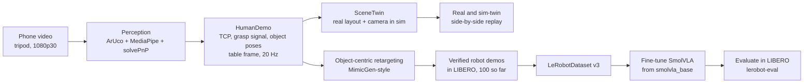
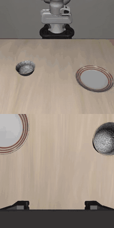
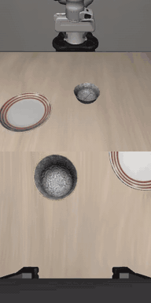
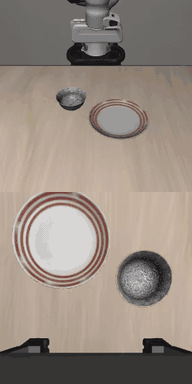

# Pipeline, constraints and generated dataset

## Pipeline

1. **Record** with a tripod and a ChArUco-calibrated camera. Printed ArUco markers sit on the table, bowl and plate.
2. **Extract** a metric TCP trajectory (midpoint of thumb tip and index tip), a grasp signal from the pinch, and the object poses, all in the table frame.
3. **Twin.** Rebuild the real layout and camera viewpoint in the simulator (`SceneTwin`) and replay the human motion on the Panda. The side-by-side video is the minimum deliverable.
4. **Multiply.** Split each demo into object-relative segments, retarget them to many simulated object poses, and keep only the successful runs.
5. **Train** SmolVLA from `lerobot/smolvla_base` (it has not seen LIBERO) on the generated data only.
6. **Evaluate** with `lerobot-eval`: success rate with a confidence interval, against baselines.

## Goal, constraints, limitations

**Goal.** Train a small VLA only with data that I recorded with a phone. The policy must do a pick-and-place task (bowl onto plate) in simulation.

**Resource constraints**

| Constraint | Effect on the design |
|---|---|
| One 16 GB GPU | Use a 450M-parameter VLA in bf16. |
| The data must come from a phone | 26 third-person clips on a tripod (12 usable after cleaning). One camera. No depth sensor. No motion-capture glove. |

**Limitations**

- **No physical robot.** The policy is evaluated in simulation only. This project makes no claim about real-world transfer.
- **Distribution shift.** The data comes from a human hand in a real room. The policy runs on a Panda in a rendered scene. The gap has four parts: appearance (real pixels and rendered pixels), embodiment (hand and parallel-jaw gripper), timing and dynamics, and object geometry. Section 3 describes how each approach treats the gap.
- **One camera, markers needed.** The metric hand pose comes from MediaPipe, `solvePnP` and ArUco markers on the table and objects. This limits where and how I can record.
- **Simplified orientation.** Retargeted grasps use a fixed top-down gripper orientation. The yaw comes from the object.
- **One task family.** Bowl on plate. This project makes no claim for other tasks.

## Generated dataset (first run)

**Generated dataset (first run).** From the 12 cleaned clips, `scripts/04_generate_dataset.py` attempted 170 rollouts in the scaled LIBERO scene (bowl x1.23, plate x1.85 of LIBERO's size, no distractors, seed 0) and kept 100 successes (59 %). Of the 70 failures, 37 never lifted the bowl and 33 timed out.

  
  
  

*First three generated episodes (agent-view camera top, wrist camera bottom, real time, subsampled from 20 to 10 fps).*

- **Each rollout:** a random bowl and plate position, and one of the 12 human demos drawn at random. There is no nearest-layout selection and no action noise; those live in `22_mimicgen_expand.py`.
- **Trajectory:** the approach (last 20 cm of the hand path) is anchored to the bowl and the carry (the bowl's path) to the plate. Grasp height, finger yaw and release height are set by the robot, not copied from the human.
- **Output:** 35 498 frames at 20 Hz with agent-view and wrist cameras. Episodes run 224 to 663 control steps (median 321.5). Many exceed the 300 steps `lerobot-eval` allows, and no length filter was applied. Metadata is in `data/e1/generated_clips/hurobo_meta.json` (not committed).
- **Run time:** roughly 40 to 50 minutes in one process. This is estimated from file times and a 12-attempt test (3 min 39 s); the real run's wall-clock time was not logged.

Caveats: 5 of the 12 clips had their release-distance QC gate waived. The 59 % is the generator's success rate, not a trained policy's. I have not checked how many of the 100 episodes come from each source clip.
