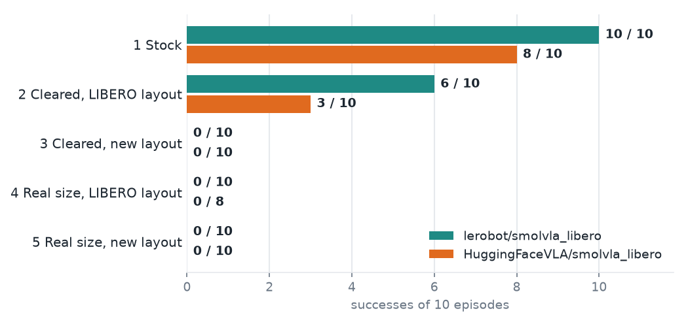
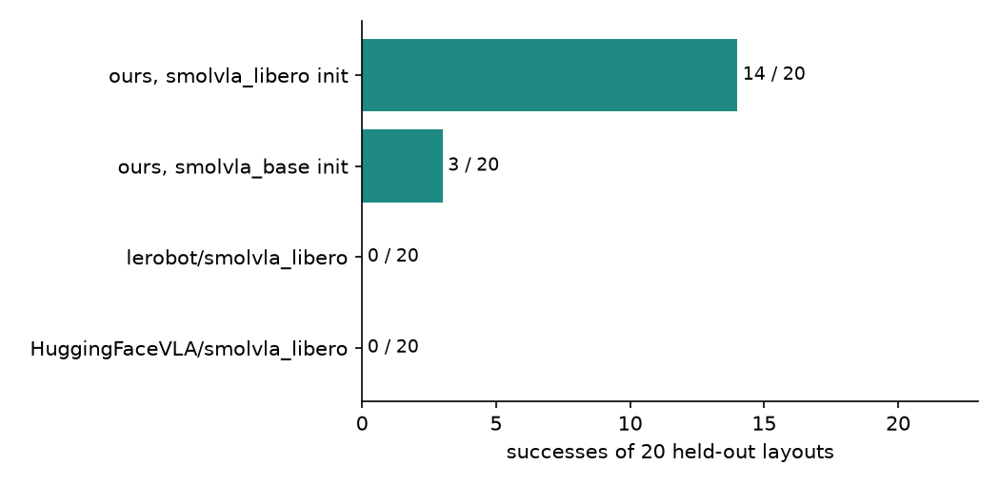

# Results: pretrained checkpoints and fine-tuned SmolVLA

### Pretrained SmolVLA checkpoints in five scenes

No training by me. The two most-liked LIBERO checkpoints on the Hub drive the Panda in the simulator; success is LIBERO's own check. Same layouts for both checkpoints, 300 steps, new action chunk every 10 steps, 10 episodes per cell (one cell has 8). Source: [09_smolvla_benchmark](../examples/09_smolvla_benchmark.ipynb) and [D-011](design_decisions.md).

  

1. **Stock:** LIBERO's own scene and start positions.
2. **Cleared, LIBERO layout:** other objects removed; bowl and plate start where LIBERO puts them.
3. **Cleared, new layout:** other objects removed; bowl and plate at random positions.
4. **Real size, LIBERO layout:** bowl and plate at the measured real sizes (plate 1.86x wider); LIBERO's placement. HuggingFaceVLA has 8 episodes here.
5. **Real size, new layout:** real sizes at random positions, the target scene of my experiment.

Reading: the success of both checkpoints depends strongly on where the objects start and on their size. A new layout alone takes the better checkpoint from 6/10 to 0/10, and real-size objects give 0 even on LIBERO's own layout. Removing the other objects already lowers success (scene 1 to 2). With 10 episodes per cell the 95% Wilson interval of 0/10 is 0 to 28%, so small differences mean nothing. The cause is not established: candidates not yet tested are the fixed start positions the checkpoints saw in training and the removed distractors. This is why the question above is open: a policy trained on one fixed layout does not carry over to a new layout or a new object, and whether human video fixes that is what the experiment below is for.

### Planned experiment

Target task, N = 50 episodes, Wilson 95% CI. Only the two SmolVLA rows have been run, with 10 episodes instead of 50:

| Policy | Trained on | Success |
|---|---|---|
| `smolvla_base` zero-shot | nothing from LIBERO | pending |
| Open-loop retarget replay | one human demo for each rollout, no learning | pending |
| **SmolVLA (ours)**, final checkpoint (step 3000) | 100 generated episodes from 12 phone clips, expert-only fine-tune, 3000 steps | 2/10 (95% CI 6 to 51%); N = 10, not 50. Per checkpoint (500 to 3000): 0, 2, 1, 1, 4, 2 of 10 |
| **SmolVLA (ours), `smolvla_libero` init** | the same 100 generated episodes, starting from the weights of `lerobot/smolvla_libero` instead of `smolvla_base`; same settings | Per checkpoint (500 to 3000): 2, 1, 7, 5, 8, 7 of 10; best step 2500 at 8/10. Held-out result below |
| ACT (ours) | same data | pending |

This table will contain only numbers from runs that were executed. Failed runs are included.

**Second experiment: start from `lerobot/smolvla_libero`.** The first fine-tune starts from `smolvla_base`, which has never seen LIBERO. The second starts from `lerobot/smolvla_libero`, which was trained on LIBERO's own demonstrations: it succeeds 10/10 on the stock scene but 0/10 in the scaled scene (scene 5 above). The question is whether that prior helps once the policy is fine-tuned on demonstrations generated from my 12 clips, or gets in the way.

Everything else matches the first run so the two are comparable: the same 100 generated episodes, expert-only training (vision encoder frozen), batch 16, 3000 steps, one seed. The run is started with `scripts/19_train_smolvla.py ... --init-from lerobot/smolvla_libero` and each checkpoint is evaluated with `23_eval_checkpoints.py` (10 episodes, layouts 0 to 9). The best checkpoint of each run is then compared on held-out layouts (100 and up) against the two pretrained checkpoints in [notebook 14](../examples/14_smolvla_model_comparison.ipynb).

**Result (held-out layouts 100 to 119, 20 episodes each, scaled scene, best checkpoint of each run at step 2500):**

  

The `smolvla_libero` init beats the `smolvla_base` init, and the two intervals do not overlap. Both fine-tunes beat the pretrained checkpoints in this scene, which they were never trained for. The pretrained policies' open-loop error says how far they are from our demonstrations, not how good they are. Source: [notebook 14](../examples/14_smolvla_model_comparison.ipynb), `results/smolvla_compare/`, `results/smolvla_libero_init_ckpts/`.

Limits: one seed per run and N = 20. The best checkpoint was picked on layouts 0 to 9 and tested on layouts 100 to 119, so the 14/20 is not a selection artefact, but it is one seed and the layouts are random draws from the same generator as the training data. No zero-shot `smolvla_base` or open-loop replay baseline has been run, so the data's own contribution is still not isolated. The best checkpoint is picked on the layouts it is first evaluated on, which is why the held-out comparison exists.

**Reading the SmolVLA row.** Closed loop in the scaled scene (real-size bowl and plate, other objects removed, random layouts, 500-step limit), with the same 10 layouts for every checkpoint and one training seed.

- **Success:** step 2500 is best at 4/10 (interval 17 to 69%); the final checkpoint is 2/10. All intervals overlap, so the six checkpoints cannot be told apart.
- **Failures:** most runs never bring the gripper within 6 cm of the bowl (6 to 9 of 10 at every checkpoint).
- **Open loop:** position error on training frames falls from 0.113 to 0.084 (an all-zero chunk scores 0.137), and gripper sign accuracy rises from 0.92 to 0.96. This measures fit on frames the model was trained on, not generalisation.
- **Caveats:** the two public checkpoints scored 0/10 in the same kind of scene (scene 5 above), but in a separate, unpaired evaluation. The training set includes 5 clips with the release-distance QC gate waived (7 passed). No zero-shot or open-loop replay baseline has been run, so the data's contribution is not isolated.

Source: [notebook 13](../examples/13_smolvla_checkpoints.ipynb), `results/smolvla_ckpts/`, [D-013](design_decisions.md).
